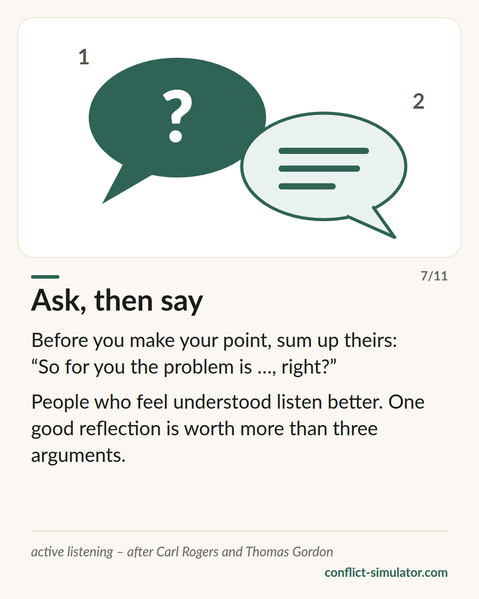

# Active listening

*Say back what you heard — then answer. The move the practice room asks for most often, and one of the best-supported on this site.*

## What the model says

Active listening means saying back, in your own words, what the other person has said — content and feeling — before you add anything of your own. “So you are saying the agreement was not clear to you, and you are annoyed that I am holding it against you now.” Then you stop and check whether you got it right.

That is more than nodding. It has three parts: reflecting (paraphrasing and mirroring the feeling), open questions that do not already contain the answer, and summarising before the conversation moves on. In motivational interviewing the set is called OARS: open questions, affirming, reflecting, summarising.

The point: people who feel understood no longer have to defend themselves — and can listen. Active listening is not agreement. You can say back what someone means and then disagree.

## Where it comes from

Carl Rogers and Richard Farson coined the term in 1957 in a training booklet for managers in Chicago; Rogers knew reflecting from client-centred therapy. Thomas Gordon, his student, made it the second half of his model in 1970 — the I-message for your own concern, active listening for the other person's. William Miller and Stephen Rollnick ordered the technique into OARS in motivational interviewing.

For a conversation tool the evidence is good. Guy Itzchakov and Avraham Kluger showed in several experiments (2017, 2018) that people who are listened to attentively become less defensive, see their own position with more nuance and feel safer. Weger and colleagues (2014) found that people who are paraphrased feel more understood than with advice or agreement. Reflective listening is also the core of motivational interviewing, whose effects meta-analyses document. Less supported: that the technique alone resolves a conflict that is already stuck.

**Evidence:** Well supported — experiments and meta-analyses on counselling talk

## What you can do with it before the conversation

### Prepare your first reflecting sentence

Have an opening ready: “If I understand you right, …”, “So you are saying …”. And the feeling with it, as a guess: “… and that annoys you.” The other person corrects you when you are wrong — that is the whole purpose.

### An open question instead of an argument

After reflecting, not your counter-argument straight away. First: “What would be a good solution for you?” or “What bothered you most about it?” Questions that yes or no do not answer.

### Summarise before you propose

Two sentences: what the other person wants, what you want. Only then the request. Whoever summarises first often notices that the request has to come out differently than planned.

## Where the Conflict Simulator uses it

In the [practice room](https://conflict-simulator.com/en/practise) the meter under every answer of the counterpart shows whether you listened before you spoke: “Listening ✓” appears when your line reflects or asks instead of explaining. The coach asks for exactly this move in the time-out, and the debrief names the places where you skipped it.

In the [wizard](https://conflict-simulator.com/en/start), “When they answer” asks for your listening line for the conversation card; the rules on [I statements](ich-botschaften.md) are its other half. The [card “Ask, then say”](https://conflict-simulator.com/en/cards) shows it on one page.

## Limits

Active listening that sounds like a technique — “I hear you saying …” — is heard as one and makes people angry. It does not replace an answer: whoever only reflects and never says what they want comes across as evasive. And it assumes the other person wants to talk at all; with threats, contempt or a clear imbalance of power, listening is not a move but stalling. Then the red band of the triage applies.

## Sources

- [Rogers & Farson (1957): Active Listening. Industrial Relations Center, University of Chicago (PDF)](https://wholebeinginstitute.com/wp-content/uploads/Rogers_Farson_Active-Listening.pdf)
- [Itzchakov & Kluger (2017): Can holding a stick improve listening at work? Academy of Management Discoveries 3(4)](https://doi.org/10.5465/amd.2016.0113)
- [Itzchakov & Kluger (2018): The Power of Listening in Helping People Change. Harvard Business Review](https://hbr.org/2018/05/the-power-of-listening-in-helping-people-change)
- [Weger, Castle Bell, Minei & Robinson (2014): The relative effectiveness of active listening. International Journal of Listening 28(1)](https://doi.org/10.1080/10904018.2013.813234)
- [Miller & Rollnick: Motivational Interviewing (OARS) — Motivational Interviewing Network of Trainers](https://motivationalinterviewing.org/understanding-motivational-interviewing)

Page: https://conflict-simulator.com/en/background/active-listening
