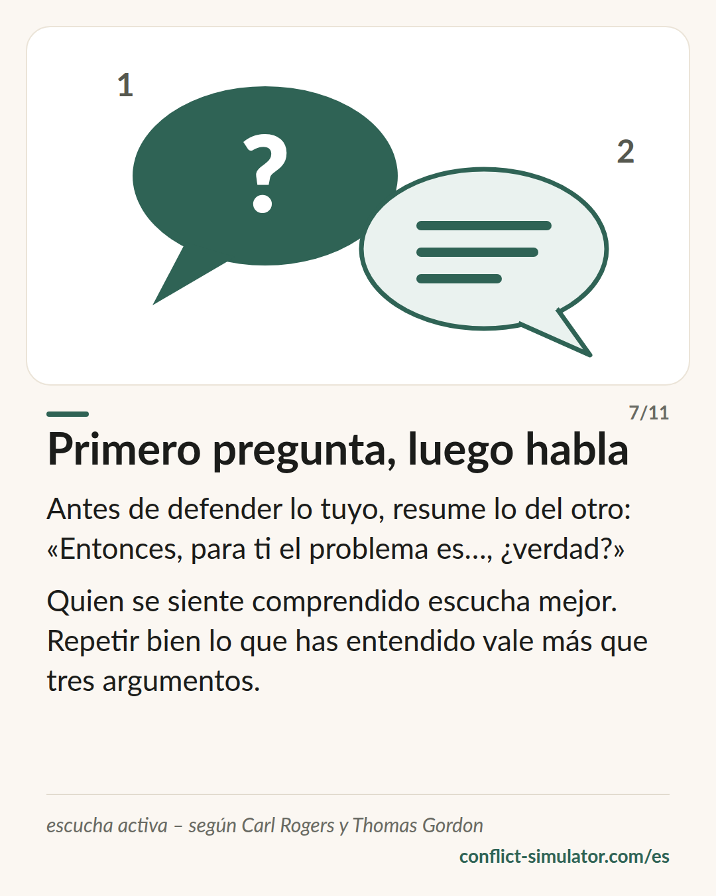

# Escucha activa

*Primero devuelve lo que has oído; después responde. La jugada que la sala de práctica reclama más veces, y una de las mejor respaldadas de esta web.*

## Qué dice el modelo

Escucha activa significa devolver, con tus palabras, lo que la otra persona ha dicho —el contenido y el sentimiento— antes de añadir nada tuyo. «O sea, que el acuerdo no te quedó claro, y te molesta que ahora te lo eche en cara.» Después callas y compruebas si lo has entendido.

Es más que asentir. Tiene tres partes: reflejar (parafrasear y devolver el sentimiento), preguntas abiertas que no lleven ya la respuesta dentro, y resumir antes de que la conversación siga. En la entrevista motivacional el conjunto se llama OARS: preguntas abiertas, afirmar, reflejar, resumir.

La clave: quien se siente comprendido ya no tiene que defenderse, y puede escuchar. La escucha activa no es estar de acuerdo. Puedes devolver lo que alguien quiere decir y, después, discrepar.

## De dónde viene

Carl Rogers y Richard Farson acuñaron el término en 1957 en un cuaderno de formación para directivos en Chicago; Rogers conocía el reflejo de la terapia centrada en el cliente. Thomas Gordon, su alumno, la hizo en 1970 la segunda mitad de su modelo: el mensaje yo para lo tuyo, la escucha activa para lo del otro. William Miller y Stephen Rollnick la ordenaron como OARS en la entrevista motivacional.

Para una herramienta de conversación, la evidencia es buena. Guy Itzchakov y Avraham Kluger mostraron en varios experimentos (2017, 2018) que quien es escuchado con atención se pone menos a la defensiva, ve su postura con más matices y se siente más seguro. Weger y colegas (2014) hallaron que quien es parafraseado se siente más comprendido que con un consejo o un «tienes razón». La escucha reflexiva es además el núcleo de la entrevista motivacional, con efectos documentados en metaanálisis. Menos respaldado: que la técnica, por sí sola, resuelva un conflicto ya enquistado.

**Respaldo:** Bien respaldada: experimentos y metaanálisis sobre la conversación de ayuda

## Qué puedes hacer con él antes de la conversación

### Prepara tu primera frase de reflejo

Ten un arranque listo: «Si te entiendo bien, …», «O sea, que …». Y el sentimiento al lado, como hipótesis: «… y eso te molesta.» Si te equivocas, la otra persona te corrige: para eso sirve.

### Una pregunta abierta en lugar de un argumento

Después de reflejar, no vayas directo a tu contraargumento. Primero: «¿Qué sería para ti una buena solución?» o «¿Qué fue lo que más te molestó?». Preguntas a las que no se contesta con sí o no.

### Resume antes de proponer

Dos frases: qué quiere la otra persona, qué quieres tú. Solo entonces la petición. Quien resume antes suele notar que la petición debe salir distinta de lo planeado.

## Dónde lo usa el Simulador de Conflictos

En la [sala de práctica](https://conflict-simulator.com/es/practicar), el medidor bajo cada respuesta del interlocutor muestra si escuchaste antes de hablar: «Escucha ✓» aparece cuando tu frase refleja o pregunta en vez de explicar. El coach reclama esa jugada en la pausa, y la evaluación nombra dónde te la saltaste.

En el [asistente](https://conflict-simulator.com/es/empezar), «Cuando la otra persona responde» te pide tu frase de escucha para la tarjeta de conversación; las reglas sobre [mensajes yo](ich-botschaften.md) son su otra mitad. La [tarjeta «Primero pregunta, luego habla»](https://conflict-simulator.com/es/tarjetas) es el modelo en una página.

## Límites

Una escucha activa que suena a técnica —«Oigo que dices que…»— se oye como técnica y enfada. No sustituye a una respuesta: quien solo refleja y nunca dice lo que quiere parece evasivo. Y da por hecho que la otra persona quiere hablar; con amenazas, desprecio o un claro desequilibrio de poder, escuchar no es una jugada, sino dar largas. Entonces rige el nivel rojo.

## Fuentes

- [Rogers & Farson (1957): Active Listening. Industrial Relations Center, University of Chicago (PDF, en inglés)](https://wholebeinginstitute.com/wp-content/uploads/Rogers_Farson_Active-Listening.pdf)
- [Itzchakov & Kluger (2017): Can holding a stick improve listening at work? Academy of Management Discoveries 3(4)](https://doi.org/10.5465/amd.2016.0113)
- [Itzchakov & Kluger (2018): The Power of Listening in Helping People Change. Harvard Business Review](https://hbr.org/2018/05/the-power-of-listening-in-helping-people-change)
- [Weger, Castle Bell, Minei & Robinson (2014): The relative effectiveness of active listening. International Journal of Listening 28(1)](https://doi.org/10.1080/10904018.2013.813234)
- [Miller & Rollnick: entrevista motivacional (OARS) — Motivational Interviewing Network of Trainers](https://motivationalinterviewing.org/understanding-motivational-interviewing)

Página: https://conflict-simulator.com/es/fondo/escucha-activa
